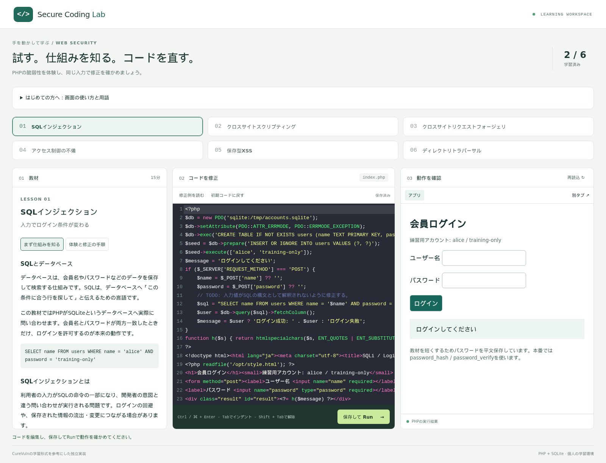

# Secure Coding Lab

教材・PHPエディタ・実行画面を並べて、脆弱性の体験から修正まで進めるローカル研修アプリです。CureVulnの学習形式を参考に、コードと教材を新しく実装しました。CureVuln本体のフォークや公式後継ではありません。



## 起動

Docker Engine / Docker DesktopとDocker Compose v2が必要です。初回ビルドにはインターネット接続を使います。

```sh
git clone https://github.com/ryuchan00/secure-coding-lab.git
cd secure-coding-lab
docker compose up --build -d
```

[http://localhost:8080](http://localhost:8080) を開きます。8080〜8084番ポートを使用します。教材の実行にNode.jsやPHPをホストへインストールする必要はありません。

1. 左の教材を読み、右のフォームで通常入力と攻撃入力を試す。
2. 中央のPHPを修正し、「保存して Run」またはCtrl / Command + Enterで反映する。
3. 同じ攻撃入力が防がれ、通常操作が引き続き成功することを確認する。
4. 必要に応じて修正例を読む。「学習済み」は自己確認の記録であり、自動採点ではない。

コードはDockerの名前付きボリュームに保存されます。学習済みの記録はブラウザのlocalStorageに保存されます。未保存のコードは教材切替・画面離脱時に確認します。

## 教材

| 教材 | 体験 | 修正 | 目安 |
| --- | --- | --- | --- |
| SQLインジェクション | SQLiteのクエリを入力で変えて認証を回避 | PDOのプリペアドステートメント | 15分 |
| XSS | 入力したJavaScriptが実際にブラウザで実行される | HTML本文に出力する直前のエスケープ | 15分 |
| CSRF | 別オリジンのページからCookie付き送金POST | セッション固有トークンの検証 | 20分 |

SQLi教材は仕組みに集中するためパスワードを平文保存しています。本番の認証ではハッシュ化と`password_verify`なども必要です。修正例は各演習の対象脆弱性を直す例であり、本番用アプリの完成形ではありません。

CSRF教材は`localhost:8083`と`localhost:8084`を使います。異なるポートは別オリジンですが同一サイトなので、`SameSite=Lax`でもCookieが送られます。CSRFトークンがこの状況を防ぐことを確認する演習です。クロスサイトCookie制限を無効にする操作は不要です。

## 研修での利用範囲

1人につき1つのDocker環境を起動します。複数人で1つのインスタンスを共有するとコードが上書きされます。認証・受講者管理・講師用集計はありません。

意図的に脆弱なPHPを実行するため、公開Webサーバーへの配置やポートの全インターフェース公開は行わないでください。既定では127.0.0.1だけにポートを公開します。信頼できない第三者にPHPの実行権を与えるサービス向けのサンドボックスではありません。

PHPは非root・読み取り専用ルートファイルシステムのコンテナで実行し、メモリ・CPU・プロセス数を制限しています。PHPのネットワークはinternalにし、ブラウザからのHTTPだけをnginxゲートウェイで受けます。Dockerソケットやホストのホームディレクトリを演習コンテナへ渡しません。エディタとプレビューは別オリジンで、編集APIではHostとOriginを確認します。

## 停止・復旧

```sh
# 停止。編集したコードは残る
docker compose down

# PHPの実行状態を戻す（CSRF残高・セッション、SQLiのDBを初期化）
docker compose restart sqli xss csrf

# この研修環境の保存コードも削除して初期状態からやり直す
docker compose down -v
docker compose up -d
```

「初期コードに戻す」は選択した教材のコードだけを戻します。CSRFの残高を戻すには上記のrestartを使ってください。構文エラーはプレビューに表示されます。無限ループなどで反応しない場合もrestartで復旧できます。

ブラウザでは`localhost:8080`を使用してください。プレビューURLはlocalhostに固定されています。WSLではDocker DesktopのWSL連携を有効にし、Dockerエンジンが起動していることを確認します。

## 開発と検証

Python標準ライブラリが編集APIと静的画面を配信し、PHP 8.4とSQLiteで演習を実行します。コードエディタはCodeMirror 5を同梱し、PHP構文色分け、行番号、自動インデント、括弧対応表示を提供します。編集時に外部CDNへ接続しません。Node.jsとPlaywrightはブラウザテスト専用です。

```sh
npm ci
npx playwright install --with-deps chromium
docker compose up --build -d
npm test
```

PlaywrightはSQLiの認証回避、XSSのJavaScript実行、CSRFのCookie付き別オリジン送信をブラウザで確認し、修正後の拒否と正常系も確認します。テストは教材コードを書き換えて最後に初期コードへ戻すため、学習中のインスタンスでは実行しないでください。CIでは新しい環境を起動します。

| パス | 内容 |
| --- | --- |
| `app/` | 編集API、画面、CSRF攻撃ページ |
| `lessons/` | 新規作成した教材・初期コード・修正例 |
| `runtime/` | PHP実行環境とゲートウェイ |
| `tests/` | ブラウザでの動作検証 |

## CureVulnとの関係

2017年度未踏事業の[CureVuln紹介資料](https://www.ipa.go.jp/archive/files/000065633.pdf)にある、教材・エディタ・アプリを並べる学習形式を参考にしています。[元の公開教材](https://github.com/curevuln/curevuln-exercise)は調査しましたが、リポジトリ全体のライセンスを確認できなかったため、ソース・教材・画像は転載していません。本プロジェクトの実装と教材はMITライセンスです。

PHPのファイル更新保護を無効にしているため、保存したコードは次のリクエストですぐ反映されます。
